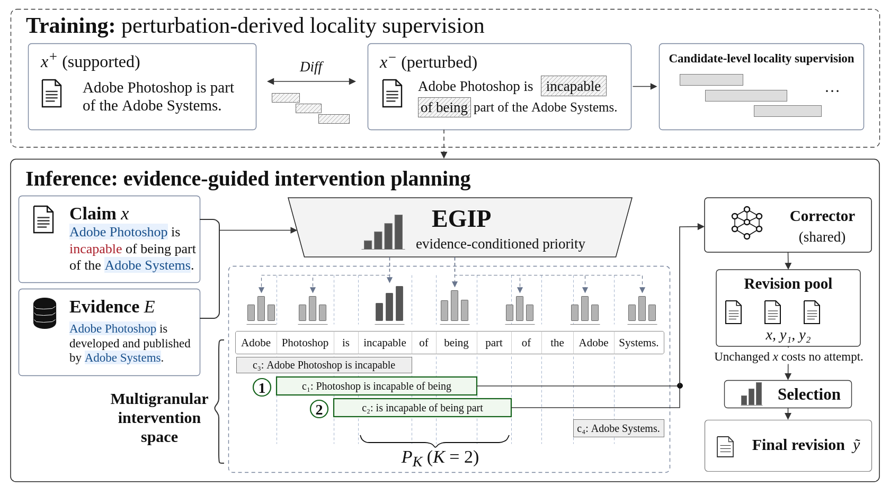

# Evidence-Guided Correction

## 基于证据的文本纠错与预算分配

**当一段文本包含事实错误，如何依据给定证据，优先修改最值得修改的部分，并控制纠错尝试次数？**

EGIP（Evidence-Guided Intervention Planning）研究这个问题。本仓库围绕问题、关键设计与可运行流程展示研究实现，包含方法代码及训练与评估入口。研究处于投稿准备阶段，代码对应 v4 方法。

## 解决什么问题

知识问答、文档摘要与内容生成需要文本与证据一致。局部事实错误可能藏在关系、属性或否定表述中。仅按文本相关性选择修改位置，未必能找到错误；反复尝试修改又会消耗生成预算。

这里研究的输入是 **待核验文本 + 已提供的证据**，输出是最终修订文本。检索证据与业务知识库接入属于后续应用环节。上述场景解释应用动机，本项目的验证来自研究数据集。

## 怎么解决

1. **把整句纠错拆成可选择的局部干预。** 保留不同长度及相互重叠的候选片段，为同一个错误提供不同修改范围。
2. **学习“哪里值得改”。** 从支持文本与扰动文本的差异构建局部监督，训练依据证据判断候选优先级的模型。
3. **把尝试次数当作约束。** 联合优先级、相关性与候选多样性安排尝试顺序；主要设置为 `K = 2`。K 约束纠错尝试数，实际费用与延迟还受模型、输入长度和部署方式影响。
4. **把改写与最终选择分开。** 每次尝试独立使用原文，共享同一个纠错模型；选择器比较修订与未修改原文。原文作为备选不占纠错尝试，但选择本身仍有计算开销。



## 一个直观例子

以下为虚构 SDK 的说明，用于解释流程：

| 输入 | 内容 |
| --- | --- |
| 待纠错文本 | Atlas SDK supports legacy Python and cannot run on Linux. |
| 给定证据 | Atlas SDK requires modern Python and supports Linux. |
| 值得关注的片段 | `legacy Python`、`cannot run on Linux` |

方案先安排局部干预，再分别生成修订并选择输出。下面的 CPU 示例调用真实的候选构造、排序与遮盖代码，使用显式设置的演示优先级和 TF-IDF 向量，便于观察流程。**它不加载学习模型，不调用大模型，也不展示纠错准确率。**

```bash
python -m venv .venv
source .venv/bin/activate
python -m pip install -e .
python examples/planning_walkthrough.py --budget 2
```

将 `--budget` 改为 `1` 或 `3`，可观察预算对计划的影响。实际模型推理见 [训练、推理与评估](docs/REPRODUCIBILITY.md)。

## 能力体现在哪里

| 技术判断 | 本项目中的实现 | 代码入口 |
| --- | --- | --- |
| 问题拆解 | 将纠错拆为监督构造、候选规划、生成与选择 | [设计说明](docs/DESIGN.md) |
| 训练数据设计 | 将扰动差异对齐为候选级监督 | [监督构造](src/egip/localization.py) |
| 受预算约束的算法设计 | 优先级、相关性与多样性共同决定干预顺序 | [候选与排序](src/egip/candidates.py) |
| 模型组合 | 优先级模型、共享纠错器与修订选择器协作 | [纠错入口](scripts/run_correction.py)、[选择器](src/egip/selection.py) |
| 实验与评估设计 | 对齐比较条件，区分开发数据与测试评估 | [评估入口](scripts/evaluate.py)、[方法测试](tests/) |

这些实现展示了从问题定义、监督设计到算法比较与输出评估的研究过程。

## 进一步了解

- [关键设计与适用范围](docs/DESIGN.md)
- [安装与模型资源](docs/INSTALL.md)
- [数据来源与下载](docs/DATA.md)
- [训练、推理与评估](docs/REPRODUCIBILITY.md)

完整模型流程需要外部模型与 GPU；EGIP 优先级权重的下载入口仍在准备。仓库包含必要的方法与评估代码，以及用于选择的拟合模型参数；不包含原始或预处理语料、完整实验输出、私人工作记录和第三方 baseline 项目。

## License

原创 EGIP 代码使用 [MIT](LICENSE)。外部数据、模型与评估器保留各自许可，详见 [第三方说明](THIRD_PARTY.md)。
